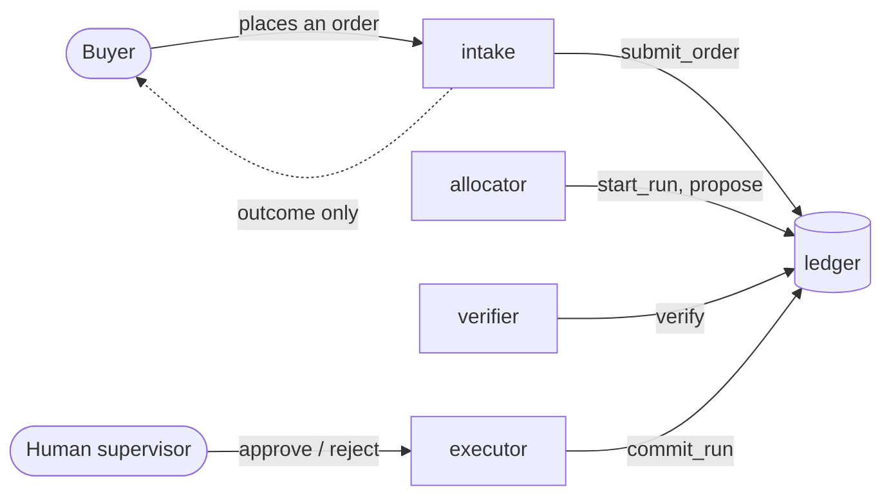

# Conomi

Conomi is a fabric-allocation workflow where a distributor's staff, a buyer, and four AI agents
coordinate inside a [Switch](https://www.switchagents.ai) room, with a deterministic ledger
underneath that decides what actually gets cut and committed. Switch gives the humans and the
agents a shared place to work; Conomi is what keeps that coordination honest once a decision
touches real, finite stock.

Built for the [Flip the Switch hackathon](https://www.wemakedevs.org/hackathons/switch).

See [`docs/architecture.md`](docs/architecture.md) for how the pieces fit together, with diagrams.



## What's in this repo

| Path | What it is |
|---|---|
| `conomi/` | The ledger service: the allocation engine, the order/run lifecycle, and the MCP tool surface agents call. |
| `switch-agents/` | Each agent's own instructions and tool scoping, and the paste-ready commands to set up the two Switch rooms. |
| `scripts/` | Seeding the demo scenario, running the quality gate, and a small direct-MCP-call tool for the one operation that happens outside the room (withdrawing a roll). |
| `tests/` | Unit, property-based (via `hypothesis`), and integration tests. |
| `docs/architecture.md` | The system design, with diagrams. |

## Stack

- **Python 3.12**
- **FastAPI** + **uvicorn** for the HTTP health surface
- **`mcp`**, the official Model Context Protocol SDK, for the agent-facing tool surface
- stdlib **`sqlite3`**, WAL mode, a single writer process, no ORM
- **`decimal.Decimal`** for every length and quantity value; never `float`, mechanically enforced
- **`pytest`** + **`hypothesis`** for tests, including a property-based invariant suite
- **`ruff`** + **`mypy --strict`** as the quality gate

Exact versions are pinned in `conomi/pyproject.toml`.

## Setting it up

### 1. The ledger service

```bash
cd conomi
python3 -m venv .conomi
source .conomi/bin/activate
pip install -e .
pip install pytest==9.2.0 hypothesis==6.170.14 ruff==0.17.3 mypy==2.4.1

# confirm everything's green: ruff, mypy --strict, a float-usage guard, pytest
./scripts/check.sh
```

Seed the demo scenario's inventory (idempotent, safe to re-run against a fresh database, but
**not** once an order has been submitted against it, since clearing a SKU an order still
references would violate the schema's own foreign key by design):

```bash
python scripts/seed_inventory.py
```

Start the MCP server every agent below will talk to. It's one process, over HTTP, shared by all
four agents, never spawned per agent, since that would mean one SQLite connection per agent
instead of the single writer this project's whole safety argument depends on:

```bash
CONOMI_LOG_LEVEL=INFO python -m conomi.mcp
```

Set `CONOMI_LOG_LEVEL=DEBUG` instead to also see each tool call's exact arguments and result,
useful while setting things up for the first time. `CONOMI_DB_PATH` (default `conomi.db`),
`CONOMI_MCP_HOST` (default `127.0.0.1`), and `CONOMI_MCP_PORT` (default `8000`) are all
overridable the same way.

### 2. Switch

Conomi doesn't implement any of Switch's own room/role/agent machinery. It's a consumer of
Switch's MCP surface, the same way the ledger is a consumer of SQLite. You'll need a Switch server
running (Switch Console can start one locally for you) and a messaging app connected to it. This
build uses Discord; nothing here is specific to it beyond the setup steps you'd click through in
Switch Console. See [Switch's own docs](https://docs.switchagents.ai) for connecting a messaging
app.

### 3. Register the four agents

Each agent gets its own directory under `switch-agents/`, containing only that agent's own
instructions and a `conomi` MCP client config scoped to exactly the tools that role needs. This is
where permission scoping actually happens, not in a role's instructions:

| Agent | Role | Can call |
|---|---|---|
| `switch-agents/intake/` | Shared | `submit_order`, `cancel_order` |
| `switch-agents/allocator/` | Exclusive | `start_run`, `propose`, `request_approval` |
| `switch-agents/verifier/` | Exclusive | `verify` |
| `switch-agents/executor/` | Exclusive | `approve_run`, `reject_run`, `commit_run`, `void_reservation`, `mark_infeasible` |

Each directory's own `README.md` gives the exact Switch Console form fields (name, description,
directory, Auto mode, Bypass permissions). `switch-agents/README.md` is the index; follow each
agent's own file when actually filling in the registration form. `executor` is the one agent that
should **not** have Bypass permissions on: its calls are the only ones that create a real
commitment, and it's built to ask before every one of them.

### 4. Set up the two rooms

`switch-agents/room/README.md` has paste-ready, single-message commands for the distributor's own
room (`fabric-allocation`): its instructions, the four roles, and two room documents (`policy-notes`
and the manifest template `executor` fills on every commit). `switch-agents/room/buyer-room.md` has
the same for the buyer's own room, plus how to link it to the distributor's room and add `intake` as
the one agent that sits in both.

### 5. Run it

`scripts/seed_inventory.md` has five natural-language order prompts to type into the two rooms,
engineered to compete for the same stock, including one order that a globally-optimal plan still
leaves short, by design, and a cross-room order placed from the buyer's own room. Typing them live
is the point: it exercises `intake`'s own extraction rather than reading data that was already
there.

## Testing

```bash
./scripts/check.sh
```

Runs `ruff`, `mypy --strict`, a guard against any `float` usage where a length or quantity is
handled, and the full `pytest` suite (unit, property-based, and integration tests against a real
SQLite file and the actual MCP tool surface).

## License

[MIT](LICENSE).
